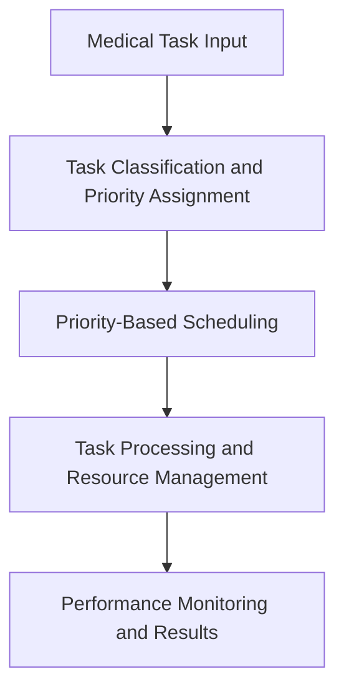

# AI-Based Medical Decision Support Platform

An Operating Systems PBL project demonstrating task management, non-preemptive priority scheduling, resource requirement simulation, and performance metrics using synthetic medical-related computational tasks.

## Team
- Group 5
- Team Leader: Avinash Kumar
- Members: Avinash Kumar, Aditya, Aryan Adhana, Ashish
- Faculty Guide: Mr. Manish Chaudhary
- Course: Operating Systems (CCSE0303A)

## Scope
This is an educational scheduling prototype. It does not diagnose patients, recommend treatment, process real patient records, or modify the Windows kernel scheduler. It does not include a trained or clinically validated AI model.

## Features
- Add, delete, and load synthetic tasks.
- Assign High, Medium, and Low priorities.
- Run custom non-preemptive priority scheduling.
- Compare with FCFS.
- Calculate waiting, turnaround, and response times.
- View result tables and charts.
- Simulate resource requirement checks.
- Export scheduling results as CSV.
- Run automated tests.

## Technologies
Python, Streamlit, Pandas, pytest; Windows 10/11 as development environment.

## OS concepts
Process/task management, CPU scheduling simulation, priority management, task queues, resource management simulation, and performance monitoring.

## Workflow


## Scheduling rules
High = 1, Medium = 2, Low = 3; lower number means higher priority. The scheduler is non-preemptive. At each decision, it selects the highest-priority task among those already arrived. Ties use earlier arrival and then input order. If the CPU is idle, simulated time advances to the next arrival.

- Turnaround Time = Completion Time − Arrival Time
- Waiting Time = Turnaround Time − Burst Time
- Response Time = Start Time − Arrival Time

## Setup on Windows PowerShell
```powershell
py -3.11 -m venv .venv
.\.venv\Scripts\Activate.ps1
python -m pip install --upgrade pip
pip install -r requirements.txt
streamlit run app.py
```
If PowerShell blocks activation, run `Set-ExecutionPolicy -Scope Process -ExecutionPolicy Bypass` in that terminal and activate again.

Run tests:
```powershell
python -m pytest -v
```

## Suggested demo
1. Load sample tasks on Dashboard.
2. Run the Priority Scheduler.
3. Inspect the execution order and metrics.
4. Compare Priority Scheduling with FCFS in Performance Analysis.
5. Open Resource Management and run the illustrative resource check.
6. Download the result CSV.

## Limitations / future work
Priorities are manually assigned; there is no trained AI model. Resource requirements are illustrative and do not allocate real system resources. All tasks are synthetic. Future work could add more algorithms and a separately validated decision-support component.

## Push to GitHub
Create an empty GitHub repository, then run:
```powershell
git init
git add .
git commit -m "Build medical decision support scheduling prototype"
git branch -M main
git remote add origin https://github.com/YOUR-USERNAME/YOUR-REPOSITORY.git
git push -u origin main
```
Replace the example URL with your actual repository URL.
